<!--
what are you looking for? that's weird... uwu ✨
-->

  

  <h2>✦ Making things feel alive</h2>

A little chaotic, a little かわいい 🐰✨  <em>systems underneath, always intentional</em>

 

## 🧃 About this space

I build systems, software, and weird little things that somehow become real ✦

A mix of code, design, experiments, and ideas that refuse to stay ideas.

Some are clean.
Some are chaotic.

All of them are intentional たぶん

I don't really follow trends.

I try things, break things, learn why they broke, and occasionally rebuild them better.
Sometimes the first version was already better. That's also data.

Everything here tends to become part of something bigger — even when it starts as a tiny repository at 2 AM かわいい

## ✦ Where things live

Most of the serious stuff eventually finds a home in one of these:

| Organization                                                                | What happens there                                                                                                              |
| --------------------------------------------------------------------------- | ------------------------------------------------------------------------------------------------------------------------------- |
| **[Sxnnyside Project](https://github.com/sxnnyside-project)**               | Utility software and everyday tools — desktop, mobile, developer tooling, libraries, and whatever else needs to exist.          |
| **[Core Red Project](https://github.com/core-red-project)**                 | Experimental software, internal infrastructure, low-level work, and ideas that probably should have stayed in the laboratory.   |
| **[Sxnnyside Scholarships](https://github.com/sxnnyside-scholarships)**     | Educational software and EdTech projects built around actual teaching and learning needs.                                       |
| **[Devil Doll Entertainment](https://github.com/devil-doll-entertainment)** | Games, interactive experiences, mods, and other things that become significantly more interesting after someone says "what if?" |

The repositories here are only a small part of the mess. The rest has organizational homes now. ✦

## 🧠 Systems I Use ✦

Not decorative. Not random.

Just tools that earned their place かわいい

  

<strong>✦ What's in the stack and why</strong>

 

**Rust** — for when correctness isn't optional

**TypeScript** — because systems need more than JavaScript-shaped optimism

**Flutter** — one codebase, real targets

**PHP** — it's still here. it still works. respect.

**C#** — when the runtime demands it

**Bun** — fast by default, no negotiation

**Deno** — when the runtime should stay small and deliberate

**PostgreSQL** — the one that rarely needs an apology

The stack adapts to the idea.

**Not the other way around.**

Some tools stayed.
Some didn't survive.

Everything evolves. That's part of the system.

## 🧩 What Never Changes ✦

Clean structure.

Clear hierarchy.

Systems that go deep.

Design that feels intentional 🐰✨

Not assembled.
Not random.

Some things get rebuilt.
Some get replaced.

But the core always stays.

## ✦ Philosophy

> Software should feel authored かわいい✨
> Not assembled. Not stitched.
> **Authored.**

## 📊 Activity ✦

  
  

## 🟣 Support the chaos ✦

  

A small way to keep these strange systems alive 🧃✨

---

  
    Built with structure. Dressed in chaos ✦
  

